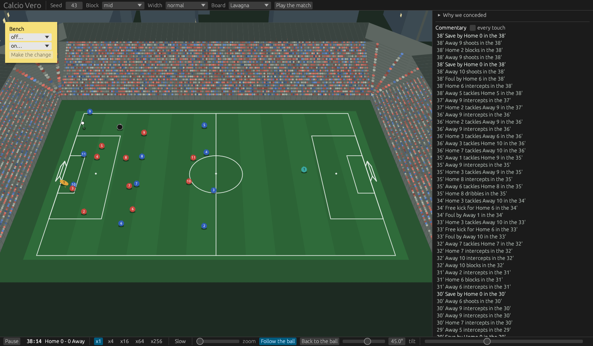

<div align="center">

<picture>
<source media="(prefers-color-scheme: dark)" srcset="assets/calcio-vero-logo-dark.svg">

</picture>

# Calcio Vero - Deep Simulator

**An open football management game where the match tells you *why*.**<br>
*No star ratings. No hidden dice. No secrets you are not allowed to read.*

[](#where-we-are-honestly)
[](https://github.com/liraan/calciovero)
[](LICENSE-MIT)
[](#build-it-with-us)
[](#ai-disclosure)

[](#support)

</div>

---

**Watch a match now** (Rust 1.85+ stable; on Windows, Git Bash or WSL):

    git clone https://github.com/liraan/calciovero.git
    cd calciovero
    cargo run --release -p ds-gui                              # the window: the 2.5D board, commentary, why you conceded
    cargo run --release --bin ds-demo -- --seed 42 --tui       # the same match on a text pitch in the terminal

More options in [Try the engine today](#try-the-engine-today).

---

> You have been here before. Your striker is "in superb form". The
> scout gave him four and a half stars. You lose 3-0 at home, and the
> match engine shrugs.
>
> Why did he miss? Was it his finishing, the defender, the pressure, the
> pass that arrived on his weak foot? Somewhere a number knows. You will
> never see it.
>
> **Calcio Vero - Deep Simulator is built on the opposite idea.**

<div align="center">


*Seed 43, engine version 138, from 38'09": a cross from the right and a header in the net, in the 2.5D view zoomed in at 50° with the camera following the ball, the board's Lavagna theme. The players are tokens with their numbers; the keeper stretches in his dive, the header lifts its man off the grass with his shadow below, and the home end rises at the goal: every movement comes from a fact of the match, nothing else. Everything is the engine's own tick record (where the twenty-two and the ball are, ten times a second), drawn by the GUI at 60 frames a second: between two ticks the players move on curves with their speed, the ball flies on the gravity the match was played with, and every curve ends exactly on the next tick. The drawing never touches the simulation ([`tools/ds-gui/DESIGN.md`](tools/ds-gui/DESIGN.md)). The terminal view is in [`assets/demo-2d.gif`](assets/demo-2d.gif).*

</div>

## If you play football managers, this is for you

You already know what makes these games great: the squad you built
yourself, the kid from the academy who made it, the season that
turned in February. Calcio Vero - Deep Simulator keeps all of that. What it changes is
**what you are allowed to understand**.

| You know this feeling… | Calcio Vero - Deep Simulator's answer |
|---|---|
| "My team played badly" is the whole post-match analysis. | **Every event has a cause you can read.** "Their 8 pressed your 6 from his blind side four times; he lost the ball twice; the second one was the goal." |
| A 4.5-star player turns out to be a 2-star player. | **The scout gives an estimate *and how sure he is*.** A narrow band is a safe signing. A wide band is a gamble, and you can see it is one. |
| Somewhere, a hidden "current ability" decides everything. | **There is no CA/PA.** A player is what he does: his characteristics, read in the situation, from his own point of view. |
| The result feels like a dice roll you are not shown. | **No die is ever rolled in a match.** What looks like luck is a cause you have not spotted yet, and the game can show it to you. |
| You cannot check the formulas, only argue about them on forums. | **Every formula is public.** Every parameter is a JSON file. Change a number, replay the same match, watch what changes. |
| You lose a great save to a patch. | **Same save + same match = same result, on every machine.** Saves are reproducible from their seed. |

## The match: decisions, and a ball with physics

The players are not puppets moved by a script. Each one is an **actor**:
he sees the pitch from where he stands, with his own vision and his own
reading of the game, and he chooses. A late pass is late *because* the
passer was under pressure and looked up a moment too slowly. A defender
who arrives a step late arrived late for a reason.

The ball is the other half. It does not choose: it has declared physical
properties, gravity, friction, the bounce off the post, computed in
integers so that the same match is the same everywhere.

That is the whole design: **the players decide, the ball obeys physics,
and every event carries the reason it happened.** The rest of the game,
from scouting to the academy, is built so that you can ask "why?" and
get an honest answer.

## What you will do as a manager

The loop is familiar, and that is the point:

```
between matches:   observe  ->  understand  ->  decide  ->  (the match)
inside the match:  watch    ->  understand  ->  adjust  ->  (watch)
```

Two cycles, one inside the other, each on its own clock. **Between
matches** you **observe** what your players actually did, through
ratings and data built from events and the reports of your staff, never
from hidden numbers; you **understand** why; you **decide** the eleven,
the tactic, the training, the signings. **Inside the match** you
**watch** it, on the tilted board of the 2.5D view or as radio commentary; you **understand**
what is happening, down to the moment and the reason; you **adjust**
from the touchline, at half-time, with the substitutions. In both,
understanding comes before acting: you change because you understood,
not because a number went up.

The soul is old-school: dense, readable screens, text commentary, a
world that reacts. Think of the depth of the modern games with the soul
of the classic Italian ones. The longer version is in
[`doctrine/VISION.md`](doctrine/VISION.md).

## Where we are, honestly

**There is no playable game yet.** The match engine is close to complete and is being calibrated against real football, one verified step at a time, in the open. Engine version **134**; **485 tests** and a health check run on every commit.

### The road, level by level

The game is built in four concentric levels; each one widens the previous and depends only on the ones inside it ([`doctrine/STRUCTURE.md`](doctrine/STRUCTURE.md)).

| Level | What it is | Status | Plan |
|---|---|---|---|
| **L0 · The match** | twenty-two players who think, a ball with physics, the Laws, the bench | 🟡 almost complete; calibration in progress | [`L0-CLOSE`](context/plans/L0-CLOSE.md), [`L0-CALIBRATION`](context/plans/L0-CALIBRATION.md) |
| **L0 · Plugins** | the match split into plugins behind one contract, the commentary out of the engine | ✅ done ([ADR-063](doctrine/adr/063-the-match-split-into-plugins.md)) | [`PLUGINS`](context/plans/PLUGINS.md) |
| **L1 · The season** | three divisions and the cup in the real Italian format, every match played by the engine | ⬜ planned, starts when L0 is closed | [`L1`](context/plans/L1.md) |
| **L2 · The career** | contracts, market, scouts, academy, growth, finances, the dressing room, the coach's life | ⬜ planned | [ADR-060](doctrine/adr/060-the-season-is-true-the-career-builds.md) |
| **L3 · Make it yours** | editor for every value, packs, a local importer for your own data, external plugins in WebAssembly | ⬜ planned | [decisions](context/plans/DECISIONS-2026-11-15.md) |
| **Interface** | desktop window today: the 2.5D view (numbered tokens with their gestures from the facts, a continuous zoom, follow the ball or drag the view, the stadium and its crowd, three themes), the bench as a post-it for substitutions while watching, commentary, why you conceded; the full design is decided | 🟡 | [`DESIGN`](tools/ds-gui/DESIGN.md) |
| **Android** | the same game, the same plugins, light asset packs | ⬜ after the desktop | [ADR-061](doctrine/adr/061-android-is-the-same-game.md) |

### Releases

| Version | When | What you get |
|---|---|---|
| **0.1 · Season** | when L1's season is done | a full season, the free tactics board, the calendar, the squad, the week, the 2.5D match; for a few testers |
| **0.2 · Market and bench** | right after the 0.1, closing L1 | contracts, transfer windows, transfers and loans, play as the sporting director; the coach's modules: signals from the bench, talks and credibility, if-then plans, the tactical meeting, the leaders |
| **0.3 · Club** | after the first half of L2 | agents, scouts, the full accounts, the board; play as the president |
| **0.4 · Career** | after L2 | growth, academy, dressing room, the board; open to everyone |
| **1.0** | after L3 | the editor, the packs, the polished interface, on desktop |

### The match against real football

Measured on 60 matches against Serie A 2017-18 (380 real matches, Wyscout open data, CC BY 4.0). A metric is *in band* when it sits within one standard deviation of the real matches. **Today 12 of 22 metrics are in band**; every metric outside has an open item with its cause. No number is ever tuned to hit a target: a distance is a question about how the players perceive, think or move.

| In band | Real | Engine | | Not yet | Real | Engine |
|---|---|---|---|---|---|---|
| goals | 2.68 | 2.62 | | aerial duels | 38.1 | 8.6 |
| shots | 24.6 | 21.6 | | fouls | 26.0 | 8.6 |
| shots on target | 8.7 | 11.8 | | throw-ins | 42.7 | 16.5 |
| pass accuracy | 83.3% | 83.9% | | goal kicks | 17.2 | 8.0 |
| corners | 10.3 | 13.5 | | free kicks | 29.5 | 12.9 |
| saves | 9.4 | 12.4 | | passes | 888 | 1245 |
| clearances | 29.5 | 37.6 | | ground duels | 183 | 124 |

The full table, with the cause of every distance, is in [`L0-CALIBRATION`](context/plans/L0-CALIBRATION.md).

## What the engine does, and what is coming

Every value an act reads comes from the player's characteristics; the full catalogue, act by act, is [`L0-match/design/ACTIONS.md`](L0-match/design/ACTIONS.md).

| Area | ✅ Done | 🟡 Partly | ⬜ To do |
|---|---|---|---|
| **The body** | top speed and acceleration by his characteristics; brake, stop, turn; his own pace; fatigue against endurance, rest at half-time | jump in the aerial duel | the timing of the jump; the second man on high balls |
| **The mind** ([ADR-052](doctrine/adr/052-every-player-thinks.md)) | every player imagines his options and picks the best he sees; a cone of sight; the memory of his last look, so he decides on what he has seen; vision, reading, anticipation, creativity, concentration; courage and composure | perception with its error ([ADR-062](doctrine/adr/062-what-a-player-sees-is-not-exact.md)) | |
| **With the ball** | control; short and lofted pass, cross, switch, through ball; carry and dribble or shield; shot with power, foot and lob; header; clearance with its error, into touch when he chooses, first time when he would be robbed before he plays ([ADR-064](doctrine/adr/064-the-choice-at-the-reception.md)) | | |
| **Without the ball** | press, challenge standing, sliding or jockeying; mark, offer, run in behind; hold the block's shape and width; intercept; cover; block a shot; react to a ball before it is played | | |
| **In goal** | dive, hold or parry, claim crosses; split the angle of his posts; throw | coming out (in his area only) | reading the shot to position himself; getting set |
| **The ball** | flight with air resistance, bounce from FIFA's rebound test, rolling, posts and crossbar, in integers so the match is the same everywhere | | spin |
| **The Laws** | kick-off and restarts; offside read as the eye sees it; fouls, advantage, cards, penalties; free kicks with the wall; extra time and the penalty shoot-out; the referee hiding nothing | stoppage time (the engine adds all the time lost) | |
| **The manager** | the eleven and the bench; block height and width; planned substitutions and the change of a tired player during the match; save, reload, replay; why you conceded each goal | instructions during the match ([ADR-059](doctrine/adr/059-the-coach-speaks-during-the-match.md)): block and width | the other instructions; an opponent coach who reacts to the match |
| **The structure** | eleven mandatory plugins behind one contract; psychology can be switched off; the commentary in its own crate | | a knock that forces a player off (it starts the injuries of L1) |

## Try the engine today

Requires **Rust 1.85+ (stable)**. On Windows, use Git Bash or WSL.

    git clone https://github.com/liraan/calciovero.git
    cd calciovero
    cargo run --release --bin ds-demo -- --seed 42 --tui

Or open the window (egui, [ADR-055](doctrine/adr/055-the-gui-is-egui-behind-the-view-model.md)): choose seed, block and width, watch the match on the 2.5D board with the commentary, click an event to go back to it, and read why you conceded. The wheel (two fingers on a touch screen) zooms from the whole pitch to about 25 m; the camera follows the ball until you drag the view, and "Back to the ball" or a double click brings it back; the tilt goes from 0° (from above) to 75°, with a slow motion and three themes. From the bench post-it you make a substitution while you watch: the match is the same up to that moment and goes on with your change. `--help` lists the options (`--seed`, `--zoom`, `--free`, `--tilt`, `--theme`, `--slow`).

    cargo run --release -p ds-gui



The first command above is the 2D debug view in the terminal: the twenty-two (`A`-`K` home, `a`-`k` away)
and the ball on a text pitch, with the events as they happen. It works
in Git Bash too. Add `--speed 60` to go faster, `--step` to advance with
Enter, `--frame 30` to print the pitch at the 30th minute. It is a debug
view, and it shows the engine as it is today, stalls included.

Play a friendly: you are the home side.

    cargo run --release --bin ds-demo -- --roster
    cargo run --release --bin ds-demo -- --seed 7 --xi A,B,C,D,E,F,G,H,I,J,K --sub 60:J=P --block high --width wide --why --save friendly.json
    cargo run --release --bin ds-demo -- --load friendly.json --tui

Run it twice: same seed, same match, to the last event. `--roster` shows
who is who: each player has a role and a body that fits it. Then open
[`L0-match/balance/`](L0-match/balance/), change a number (a role's
profile in `profiles.json`, the team's shape in `block.json`), and run it
again.

## Build it with us

Calcio Vero - Deep Simulator is not built by a studio. It is built by people who love
football and want a manager they can read to the bottom, and **it is
designed so that each of them can own a piece**. You do not need to
know the whole project, and for most pieces you do not need to code.

| You know… | Your piece | Code? |
|---|---|---|
| **football** | spot what a fan would not recognise, and tell us where (seed, minute) | no |
| **football** | tune the players' profiles, the team's shape, the duel, the keeper: plain JSON in [`L0-match/balance/`](L0-match/balance/README.md) | no |
| **the Laws of the Game** | write a law the engine does not apply yet (offside, fouls) as a small pure function | a little |
| **tactics** | add a formation, improve how a team moves without instructions | a little |
| **testing, tools, writing** | a test scenario, the 2D view, a clearer document, a translation | some / no |
| **Rust and simulation** | the engine: perception, choice, movement | yes |

Every piece has a page that says what to do and how, and a list of
open tasks for newcomers: start from **[CONTRIBUTING.md](CONTRIBUTING.md)**.
Questions go in [Discussions](https://github.com/liraan/calciovero/discussions);
nothing happens in private.

## For developers

The project is written in Rust, and organised like its own design:
concentric rings, one responsibility per directory, dependencies
pointing inward.

```
doctrine/    the rules everything obeys: foundations, vision, decisions (ADRs)
L0-match/    the match: its spec, its design notes, its parameters, its engine
tools/       the window, demo, fixtures, test harness, test runner, the reference measure
context/     how the work is done: the bookmark, the rules, the plans, the ideas, the scripts
```

Start with [`doctrine/00-foundations.md`](doctrine/00-foundations.md),
then [`doctrine/STRUCTURE.md`](doctrine/STRUCTURE.md) and
[`L0-match/README.md`](L0-match/README.md). The three rules you will
meet everywhere:

- **Three planes.** The truth (hidden), the observation (events and
  statistics), the estimate (what the manager sees). Nothing leaks from
  the first to the third.
- **No die in a simulation path**
  ([ADR-035](doctrine/adr/035-no-dice-in-simulation.md)). Determinism is
  by construction.
- **No hardcoded balance.** Every parameter lives in a file, with its
  source or with an honest "arbitrary until calibrated".

Contributions are welcome: code, docs, data, bug reports, honest
criticism. One change per PR, English for code and technical docs, a
source for every factual claim, an ADR for every decision that changes an
invariant, and a human review for everything. The full process is in
[`CONTRIBUTING.md`](CONTRIBUTING.md).

**Continuous integration.** Every push runs the full gate: build,
clippy with warnings as errors, the test suite with the golden hash,
fmt, the health check and the documentation gates
([`context/scripts/gates.sh`](context/scripts/gates.sh)). GitHub is the
primary remote ([`.github/workflows/ci.yml`](.github/workflows/ci.yml));
Codeberg is the backup, with the same gate on Woodpecker
([`.woodpecker/ci.yml`](.woodpecker/ci.yml)).

## License

**Dual license** ([ADR-006](doctrine/adr/006-license.md)):

- **Code**: `MIT OR Apache-2.0` ([`LICENSE-MIT`](LICENSE-MIT),
  [`LICENSE-APACHE`](LICENSE-APACHE)).
- **Assets and documentation**: `CC-BY-NC-SA-4.0`
  ([`LICENSE-ASSETS`](LICENSE-ASSETS)).
- **Trademarks**: the names "Calcio Vero" and "Deep Simulator", together or
  apart, and the logo are project trademarks; the licences do not grant trademark rights.

Calcio Vero - Deep Simulator uses no licensed data: no real squads, no real players, no
scraped databases. Players are fictional; the football is real. The engine is measured
against an open dataset (Wyscout, Pappalardo et al. 2019, CC BY 4.0). Real names, crests
and photos will only ever come from packs you build on your own computer, from open
sources such as Wikidata (CC0) and openfootball (public domain); the project never
hosts or links protected material ([decisions F-K](context/plans/DECISIONS-2026-11-15.md)).

Football Manager is a trademark of Sports Interactive. Calcio Vero - Deep Simulator is
not affiliated with it.

## Support

[](https://ko-fi.com/liraan)

Calcio Vero - Deep Simulator is free and open. Donations are voluntary, one-off, and do
not buy influence over the roadmap.

## AI disclosure

Some documentation and code in this repository was **drafted with AI**,
then **reviewed, corrected and owned by a human**. Every architectural
decision was made by a person; AI drafts, humans decide. We say it
openly because transparency applies to our own process too.

## Contact

Everything happens in public:
[Discussions](https://github.com/liraan/calciovero/discussions) for ideas
and questions, [Issues](https://github.com/liraan/calciovero/issues) for
bugs.

---

<div align="center">

*Transparent by design. Deterministic by construction. Yours by default.*

</div>
