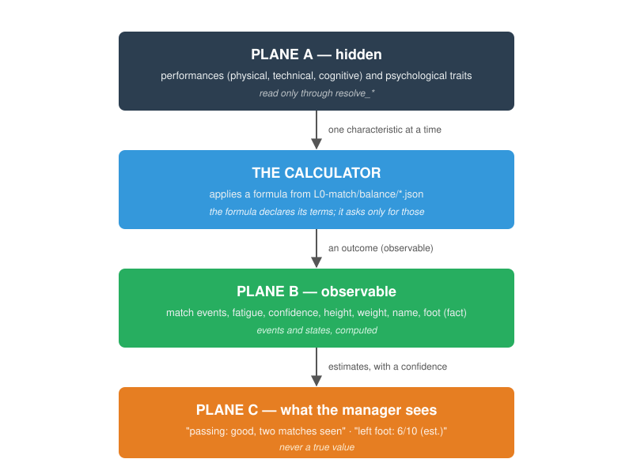

<div align="center">


# Calcio Vero — Deep Simulator

**An open football management simulation.**<br>
*Transparent by design. Deterministic by construction. Yours by default.*

[](https://github.com/liraan/calciovero)
[](https://github.com/liraan/calciovero)
[](LICENSE-MIT)
[](#ai-disclosure)

[](#support)

</div>

---

**Contents:** [Why this project exists](#why-this-project-exists) · [Three Planes](#the-core-idea-three-planes) · [The paradigm](#the-paradigm-phenomenological-simulation) · [Determinism](#determinism-taken-seriously) · [Status](#project-status) · [The engine in one glance](#the-match-engine-in-one-glance) · [The player](#the-player-what-a-footballer-is-in-this-engine) · [What makes it different](#what-makes-it-different) · [Technology](#technology) · [Getting started](#getting-started) · [Try it in 30 seconds](#try-it-in-30-seconds) · [Reading order](#reading-order-for-newcomers) · [Contributing](#contributing) · [License](#license) · [AI disclosure](#ai-disclosure) · [FAQ](#faq)

## Why this project exists

Football Manager and its ancestors built a genre. They also built walls around it: closed datasets, closed formulas, closed ecosystems. Calcio Vero is an attempt to rebuild that experience **without the walls**.

- ❌ No telemetry. Nothing leaves your machine.
- ❌ No proprietary data feeds. Open, procedural, and community packs only.
- ❌ No hidden `CA/PA` scalars pretending to be truth.
- ✅ Every formula is public.
- ✅ Every decision is documented in an ADR.
- ✅ Every save is reproducible from its seed.

> **This is not a Football Manager clone.** It's a different philosophy, applied to the same genre. Where FM optimizes for fidelity to licensed data, we optimize for **explainability and ownership**.

---

## The core idea: Three Planes

The single most important architectural choice in Deep Simulator is the strict separation of *what the simulation knows*, *what the game shows*, and *what people believe*. Collapsing these layers is what turns scouting into a lookup table — the thing every modern management sim accidentally does.

```
┌─────────────────────────────────────────────────────────┐
│  PLANE A — Ground Truth                     (hidden)    │
│  True attributes, real fatigue, latent psyche.          │
│  Readable only by the match engine and the world gen.   │
├─────────────────────────────────────────────────────────┤
│  PLANE B — Observation                      (events)    │
│  MatchEvents: shots, passes, duels.                     │
│  Ratings computed from events, never from latents.      │
├─────────────────────────────────────────────────────────┤
│  PLANE C — Estimation                       (visible)   │
│  Windowed indexes, projection bands, scout reports.     │
│  Never feeds back into Plane A.                         │
└─────────────────────────────────────────────────────────┘
```

**Why it matters:** scouting in Deep Simulator is not a lookup — it's an *estimate of an observation of the truth*. The player is meant to be uncertain. That uncertainty is the game.

Full doctrine → [`specs/00-foundations.md`](specs/00-foundations.md) · Enforcement → [ADR-003](docs/adr/003-plane-a-enforcement.md)

---

## The paradigm: phenomenological simulation

Deep Simulator does not simulate physics. It models the **observable
effects** of conditions and decisions, tick by tick. A misplaced pass is
an event with a cause (the passer's technique, the pressure he was
under, his balance), not a computed force vector. A defender arriving a
step late is a timing event, not an integration of acceleration.

This is a deliberate choice, not a shortcut. A physical engine needs
fixed-point physics, months of calibration, and data that does not exist
publicly. The phenomenological engine is deterministic, calibratable
(parameters in `balance/`, declared arbitrary until calibrated), and —
most importantly — **explainable**: every event carries the fields to
understand why it happened. "The pass was late because the pressing
closed the lane" is the target, not "the collision response exceeded the
threshold".

A physical engine is not a later step of this project: it is a different
paradigm, not planned.

## Determinism, taken seriously

Same seed → same match. **Always.** The same will hold for the season and the career when L1 and L2 exist: today the contract is local (ADR-013). This is verified on every commit by `pcfm-test-runner --check`:

```
  ✅ demo teams are valid
  ✅ same seed → same state_hash
  ✅ different seed → different state_hash
  ✅ save/load roundtrip preserves state_hash
  ✅ event chain is valid
  ✅ statistics are sane
```

The rules that make this possible are non-negotiable:

- Determinism is by construction, not by seeded stream: every outcome is a deterministic function of the state and the characteristics of the actors, and interactions emerge from the local transitions (perception, decision, movement, contact) composed geometrically. No die is drawn in a simulation path ([ADR-035](docs/adr/035-no-dice-in-simulation.md))
- `BTreeMap` (never `HashMap`) in any simulation path
- Fixed-point arithmetic for money — zero numerical drift
- Golden hash tests on every simulation change
- `SIM_VERSION` bump procedure documented in [`CHANGELOG-SIM.md`](CHANGELOG-SIM.md)

> **A note on scope:** determinism is **local** — same save + same match + same plugin configuration = same result ([ADR-013](docs/adr/013-worlds.md), accepted 2026-10-25; revised pillar 1 of the doctrine in v2.0).

---

## Project status

<div align="center">

| Level | Specification | Code |
|:-----:|:-------------:|:----:|
| **L0** — Match   | 🟢 11 cells, ratified | 🟢 10 crates, 209 tests, 6 test scenarios |
| **L1** — Season  | ⚪ 12 cells planned   | ⚪ not started |
| **L2** — Career  | ⚪ 9 cells planned    | ⚪ not started |
| **L3** — Meta    | ⚪ 8 cells planned    | ⚪ not started |

</div>

**Where we are:** L0 is **complete as a contract, ratified, implemented, and tested**. The engine is a prototype: the two tables below say what exists today and what does not. The framework compiles, the health check is green, the determinism contract is enforced, and the test harness (`pcfm-testkit`) is in place. L1 (the season) is the next specification milestone. **No playable build exists yet** — the docs have to be solid before the engine is.

**Maturity (what is settled, what is not):**

| Axis | Status | Meaning |
|------|--------|---------|
| **Doctrine** | 🟢 Settled | `specs/00-foundations.md` v2.0, ratified. The Three Planes and the bans are not under discussion. |
| **L0 specification** | 🟢 Ratified | 11 cells, ratified. The contract is stable; the implementation evolves under it. |
| **L0 implementation** | 🟡 Prototype | It compiles, it is deterministic, it is tested — but it is a *prototype model*: positions exist (slice A, used by slice B2), movement does not; 5 event types out of 31; formulas marked as placeholders. |
| **ADRs** | 🟡 Evolving | 32 ADRs: 30 accepted, 2 superseded (002 → 027, 023 → 024). The set changes as the project learns. |
| **Tests** | 🟢 Green | 209 tests, 6 test scenarios, `cargo fmt`/`clippy`/`test` clean. Green means "the contract holds", not "the game is finished". |
| **L1–L3** | ⚪ Not started | Specifications only. No code. |

**What "L0 complete" does not mean:** it does not mean the match engine is realistic. It means the L0 *contract* is ratified and implemented. Realism (movement, ball dynamics, all event types) is the positional slice (`docs/context/L0-POSITIONAL-SLICE.md`): tracked, not started (D3: L2 does not exist yet).

**Roadmap (indicative, not commitments):**

| Phase | Target |
|-------|--------|
| Prototype | Q1 2027 |
| Alpha (closed) | Q3 2027 |
| Beta | Q1 2028 |
| v1.0 | Q2 2028 |

---

## The match engine in one glance

Deep Simulator simulates one football match with 22 players, a ball, and (planned) a referee. This is what the engine does today, and where it is going. Today's engine is a **prototype**: it compiles and it is deterministic, but the models are placeholders, not calibrated. No date: the direction is fixed, the calendar is not.

| On the pitch | Today | Where it is going |
|---|---|---|
| **22 players** | They have a position on the pitch (a 4-4-2 grid). The one nearest the ball acts. | They move, and they know what they are doing: pressing, covering, running, waiting. |
| **The ball** | It is at a player's feet, or it is loose. It does not move on its own. | It moves: a pass travels, a shot flies, a loose ball rolls. |
| **The referee** | Not modelled. | He is on the pitch, blows fouls, gives cards. |
| **Assistant referees** | Not modelled. | They flag offside and out-of-play. |

### How the engine is built

| Part | Today | Where it is going |
|---|---|---|
| **Hidden truth** (`pcfm-hidden`) | The players' real attributes and the random seed. Never visible outside. | Same: the engine reads it only through the `resolve_*` functions. |
| **The engine** (`pcfm-match`) | One tick every tenth of a second. One roll decides whether something happens; five event types out of 31 are emitted. | Every player decides, every tick; the attempt and its outcome are separate, linked events. |
| **The event log** | Append-only, hash-chained. Every event carries the fields to understand why. | Same. |
| **The readers** | A text board, an HTML page, a text narrative, a save file. | A TUI. The board is not the product. |

## The player: what a footballer is, in this engine



A management game usually reduces a player to two numbers — current
ability and potential — and hides both. This engine does the opposite: a
player is a set of datums, each with a plane, a source and a consumer.
Some are visible (a document, a ruler, a scale, observation); the rest
are hidden, and the manager sees an **estimate** of each one, with a
confidence, never the true value.

| What | Plane | How the manager knows it |
|---|---|---|
| **Identity** — name, date and place of birth | B | a document |
| **Body** — height, weight | B | measured |
| **Foot** — which foot he kicks with | B | observed: a handful of touches settle it |
| **Performances** — physical, technical, cognitive | A | an estimate, with a confidence, from matches |
| **Psychological traits** — consistency, resilience, courage | A | an estimate, from behaviour over months |
| **States** — match fatigue, season fatigue, confidence, morale | B | through their effects, often with low confidence |

Two things follow, and they are the point of the design.

**There is no potential scalar.** A player grows (or does not) because of
age, playing time, training and context. "He will become great" is a
judgement the manager makes, not a hidden number the game holds.

**Every performance is explainable.** A pass is completed or not because
of the passer's technique, the pressure he was under, his fatigue, and
what he saw. Every event carries those fields, so a fan can read *why*,
not only *what*.

### Which foot, and how well

Which foot a player kicks with is **observed**, not estimated: a scout
sees it in a handful of touches, and no confidence band is needed. What
is hidden is **how well he uses each foot**: two performances, like
passing and shooting, estimated from matches like any other.

The two are separate. The foot he uses is a choice the formula makes
from the situation — the angle, the pressure, the time available — not a
fixed label; a right-footed player will use his left when the angle asks
for it, and a two-footed player has a real advantage because both
options are open. The manager knows "right-footed" as a fact and "how
good is his left" as an estimate.

### The movement, and where it is going

Movement is being rebuilt (**decided, not yet implemented**). The body
follows the same simple physics as the ball: acceleration from force and
mass, a top speed, a stride that depends on height, fatigue that reduces
the push. No arbitrary coefficients: the reference values come from real
data — a footballer's top speed and acceleration time, anthropometric
medians, GPS studies on the end-of-match drop — and a term with no
derivation does not enter the model.

What it will change, on the pitch: a stronger player accelerates faster,
a heavier one slower, a taller one covers more ground per stride, a tired
one arrives late, and the goalkeeper dives as far as his body allows
instead of a fixed reach. Every one of these is a phenomenon a fan
recognises, with a cause the engine can name.

**Today, honestly:** the engine is a prototype. Players have a position
on a 4-4-2 grid and move toward a translated slot; the ball does not
travel yet in the current build; five event types out of 31 are emitted.
The player model above is the target, documented in
[`specs/L0-match/11-player-characteristics.md`](specs/L0-match/11-player-characteristics.md),
and the movement is the first slice that moves the code toward it.

## What makes it different

| | Traditional FM | **Calcio Vero** |
|---|---|---|
| **Potential** | Secret scalar (`CA/PA`) | Transparent confidence band |
| **Attributes** | True = displayed | True ≠ displayed; displayed is an estimate |
| **Scouting** | Accurate reports | Reports with **declared bias** |
| **Telemetry** | Optional | Does not exist |
| **Data** | Proprietary (Wyscout, Opta) | Open + procedural + community |
| **Modding** | Limited tooling | Modular registry, local packs |
| **Determinism** | Partial | **Total**, verified by golden tests |
| **Privacy** | Online-adjacent | Offline-first |

---

## Technology

| Layer | Choice | Why |
|-------|--------|-----|
| Language | **Rust 1.85+** | Type safety, zero-cost abstractions, guaranteed determinism |
| Numerics | `fixed`, `libm` | Fixed-point money; portable transcendentals |
| UI | **TUI-first** (v1); `cxx-qt` + QWidgets + QML for the future GUI | Terminal UI is the primary presentation in v1; `cxx-qt` remains the binding for the GUI → [ADR-022](docs/adr/022-presentation-tui-first.md), [ADR-005](docs/adr/005-qt-binding.md) |
| Testing | `proptest`, `criterion`, Miri, ASan, **`pcfm-testkit`** | Property-based, benchmarks, UB detection, extensible coretest |
| Audit | `cargo-deny` | Dependency hygiene |
| Development | **Linux-first** | The maintainer develops and tests on Linux. Windows and macOS are supported targets, tested less frequently → [ADR-002](docs/adr/002-project-name-and-scope.md) (note 2026-11-02) |

Dependencies are pinned and justified in ADRs. No `*` versions in `Cargo.toml`. Every upgrade goes through a deliberate process.

---

## Repository layout

```
calcio-vero/
├── specs/          # specification, concentric L0–L3
│   ├── 00-foundations.md
│   └── L0-match/     # 11 cells, ratified + implemented
├── crates/           # code, one crate per architectural concern
│   ├── pcfm-core/    # primitives: RNG, time, hashing
│   ├── pcfm-model/   # domain types
│   ├── pcfm-hidden/  # Plane A — accessible only to pcfm-match (and the future pcfm-gen)
│   ├── pcfm-match/   # match engine
│   ├── pcfm-stats/   # event chain, aggregations
│   ├── pcfm-testkit/ # public test harness contract (no pcfm-* deps)
│   ├── pcfm-test-runner/ # CLI: --check, --list, --coverage
│   ├── pcfm-demo/    # CLI: simulate a match, render text/JSON/HTML
│   └── pcfm-fixtures/ # hardcoded squads and match fixture
├── docs/
│   ├── adr/          # architectural decisions, 000, 001–008, 012–035
│   └── GLOSSARY.md
└── archive/          # historical Prompt Masters (planned, currently empty)
```

Full layout and rules → [`STRUCTURE.md`](STRUCTURE.md) · Index of all modules → [`specs/_index.md`](specs/_index.md)

---

## Getting started

Requires **Rust 1.85+ (stable)**.

Commands are tested on Linux. On Windows, use Git Bash or WSL; the Rust toolchain and `cargo` are the same.

```bash
git clone https://github.com/liraan/calciovero.git
cd calcio-vero
cargo build --release
cargo run --release --bin pcfm-test-runner -- --check --seed 42
```

If `--check` prints `6/6 checks passed`, the framework is healthy. If it doesn't, something in the simulation contract is broken — please [open an issue](https://github.com/liraan/calciovero/issues).

**Inspect the test harness:**

```bash
# List the registered test scenarios
cargo run --release --bin pcfm-test-runner -- --list

# Show which features have at least one scenario, and which do not
cargo run --release --bin pcfm-test-runner -- --coverage
```

`--coverage` is the map of what the framework can do today. At the moment it shows `2/26 features covered (7%)` — L0 is complete, L1–L3 are still empty. When a module is implemented and its scenarios are registered, the percentage goes up.

---

## Try it in 30 seconds

    cargo run --release --bin pcfm-demo -- --seed 42 --board

Real output (seed 42, release build, first lines):

    +--------------------------------------------------------------+
    |                    PCFM -- MATCH BOARD                       |
    +--------------------------------------------------------------+

      Score          1  -  3
      Possession    23.6%     76.4%
      Shots          1       3
      Goals          1       3

      State hash   afca5f20344dedb96f422c67f52c2861f8cb4b9f143a3ff4f9a4691368d62556

      -- Events (29) ----------------------------------------------
      1T 0'00"      kick_off              -- 0
      1T 2'33"      pressure              Away 6
      1T 2'33"      duel                  Home 6
      1T 10'34"     pressure              Away 6
      1T 12'22"     pressure              Home 6
      1T 12'22"     GOAL                  Away 6

The board is the debug view, not the product: it shows the events, the
score, the state hash. The same match, as JSON:

    cargo run --release --bin pcfm-demo -- --seed 42 --json

Every run with the same seed produces the same state hash. That is the
determinism contract, verified on every commit. The player labels on
the board are a view-model limitation, not a simulation issue: the state
hash is unaffected.

---

## Reading order (for newcomers)

The specification is **concentric**. Read in this order:

| # | File | Answers |
|---|------|---------|
| 1 | [`specs/00-foundations.md`](specs/00-foundations.md) | *Why does this project exist? What are the non-negotiable rules?* |
| 2 | [`STRUCTURE.md`](STRUCTURE.md) | *How is the repo organised?* |
| 3 | [`specs/_index.md`](specs/_index.md) | *What exists at each level, and in what state?* |
| 4 | [`docs/adr/`](docs/adr/) | *Which decisions have been made, and why?* |
| 5 | [`docs/GLOSSARY.md`](docs/GLOSSARY.md) | *What does each term mean?* |
| 6 | [`docs/PLUGIN_DEVELOPER_GUIDE.md`](docs/PLUGIN_DEVELOPER_GUIDE.md) | *How do I write a module? How do I test it?* |

---

## Contributing

Contributions are welcome — code, docs, data, bug reports, honest criticism.

**The short version:**
- One change per PR (one module, one ADR, one fix). In Phase 1 the maintainer pushes directly on `main`; external contributors use PRs.
- English is canonical for code, commits, and technical docs → [ADR-007](docs/adr/007-canonical-language.md).
- Every factual claim needs a source. Every decision needs an ADR if it changes an invariant.
- Every contribution is **reviewed by a human**. AI may draft; humans decide.
- Determinism is not negotiable: PRs that break the seed → hash invariant require an ADR.

**Contributing tests to the coretest:**
- Implement `pcfm_testkit::Scenario` for your feature.
- Register it in `pcfm-test-runner/src/features/register_all` (or a plugin-specific registration function).
- Run `--coverage` and confirm your feature shows `[✅]`.
- See [`docs/PLUGIN_DEVELOPER_GUIDE.md`](docs/PLUGIN_DEVELOPER_GUIDE.md) §"Contributing test scenarios" for the full walkthrough.

Full process → [`CONTRIBUTING.md`](CONTRIBUTING.md)

---

## License

**Dual license** ([ADR-006](docs/adr/006-license.md), accepted):

- **Code** — `MIT OR Apache-2.0` → [`LICENSE-MIT`](LICENSE-MIT), [`LICENSE-APACHE`](LICENSE-APACHE)
- **Assets and documentation** — `CC-BY-NC-SA-4.0` → [`LICENSE-ASSETS`](LICENSE-ASSETS)
- **Trademarks** — the "Calcio Vero" name and logo are project trademarks; the licenses do not grant trademark rights

Use the code however you want. Share the assets under the same terms, for non-commercial purposes.

---

## Support

[](https://ko-fi.com/liraan)

Calcio Vero is free and open. Donations are voluntary, one-off, and do not buy influence over the roadmap (see OI-69 in [`docs/context/SESSION-STATE.md`](docs/context/SESSION-STATE.md)).

---

## AI disclosure

Some documentation and code in this repo was **drafted with AI**, then **reviewed, corrected, and owned by a human**. We say this openly because transparency applies to our own process too.

| Reality | What it means |
|---------|---------------|
| **AI drafts, humans decide** | Every architectural decision — the Three Planes, the ban on CA/PA, the determinism rules — was made by a person. |
| **AI makes mistakes** | Caught in review: a non-existent crate dependency, a hasher that would have broken determinism, a contradictory panic strategy at the FFI boundary. **Verify before you rely.** |
| **AI has no memory** | Each session starts blank. **This repository is the memory.** |
| **No unreviewed AI code** | There is no unreviewed AI-written code in this repo. Every line has a human owner. |

---

## FAQ

**Is this a Football Manager clone?**
No. It's an alternative with a different philosophy. FM is proprietary, uses closed datasets, and ships telemetry. Deep Simulator is community-driven, transparent, offline-first.

**Will you use Wyscout / Opta data?**
No. Bundling licensed datasets is ruled out by design. Provider integration is an *external tool* that produces packs, not a core module → [ADR-008](docs/adr/008-provider-integration-external.md). Open data, procedural data, and community packs (with clear provenance) only.

**Can I contribute without knowing how to program?**
Yes. The documentation needs feedback, corrections, and additions. If you understand football or game design, your input matters.

**When is the alpha?**
When L0 and L1 are stable and a minimal kernel runs. Indicatively **Q3 2027**. No promises.

**Which decisions are actually settled?**
Settled: the doctrine, the Three Planes, Plane A enforcement (ADR-003), FFI panic strategy (ADR-004), TUI-first presentation (ADR-022), Qt binding for the future GUI (ADR-005), license (ADR-006), canonical language (ADR-007), provider integration policy (ADR-008).
For ADR status, see [`STRUCTURE.md`](STRUCTURE.md) §5.

**What is `pcfm-testkit`?**
A small crate that defines the `Scenario` trait and the `TestRegistry`. It has **no dependency on any other `pcfm-*` crate**, so core modules, plugins, and tools can all contribute test scenarios without coupling. `pcfm-test-runner --check` runs them; `--list` and `--coverage` inspect them.

**How much was written by AI?**
See [AI disclosure](#ai-disclosure). Short version: drafted by AI, reviewed by a human. Every technical claim should be verified before you depend on it.

---

## Contact

- **Discussions** — [GitHub Discussions](https://github.com/liraan/calciovero/discussions)
- **Bugs / features** — [GitHub Issues](https://github.com/liraan/calciovero/issues)
- **Community chat** — *to be decided*

No private emails, no Telegram, no WhatsApp. Everything happens publicly on GitHub.

---

<div align="center">

**© 2026 Calcio Vero Team**

*Transparent by design. Open data. Your control.*

</div>
