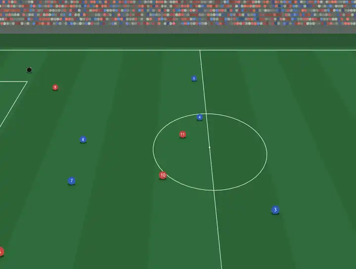

<div align="center">

<picture>
<source media="(prefers-color-scheme: dark)" srcset="assets/calcio-vero-logo-dark.svg">

</picture>

# Calcio Vero - Deep Simulator

**An open football management game where the match tells you *why*.**<br>
*No star ratings. No hidden dice. No secrets you are not allowed to read.*

[](#where-we-are-honestly)
[](https://github.com/liraan/calciovero)
[](LICENSE-MIT)
[](#build-it-with-us)
[](#ai-disclosure)

[](#support)

</div>

---

**Watch a match now** (Rust 1.85+ stable; on Windows, Git Bash or WSL):

    git clone https://github.com/liraan/calciovero.git
    cd calciovero
    cargo run --release -p ds-gui-desktop                       # the Lavagna desktop prototype
    cargo run --release --bin ds-demo -- --seed 42 --tui       # the same match on a text pitch in the terminal

More options in [Try the engine today](#try-the-engine-today). New here?
[CONTRIBUTING.md](CONTRIBUTING.md) has a 15-minute reading path that starts from zero.

---

> You have been here before. Your striker is "in superb form". The scout
> gave him four and a half stars. You lose 3-0 at home, and the match
> engine shrugs.
>
> Why did he miss? His finishing? The defender? The pressure? The pass
> that arrived on his weak foot? Somewhere a number knows — and you
> will never see it.
>
> **Calcio Vero - Deep Simulator is built on the opposite idea.**

<div align="center">



*Seed 43, engine version 138, from 38'09": a cross from the right and a
header in the net. The players are tokens with their numbers; the keeper
stretches in his dive, the header lifts its man off the grass with his
shadow below, and the home end rises at the goal. Every movement comes
from a fact of the match, nothing else.*

*The plan is to draw the engine's own tick record — where the twenty-two and
the ball are, ten times a second — in the 2.5D view at 60 frames a second:
between two ticks the players move on curves at their own pace, the ball
flies on the gravity the match was played with, and every curve ends exactly
on the next tick. The desktop GUI is currently a Lavagna prototype, not yet
connected to a match ([`context/plans/GUI-DESIGN.md`](context/plans/GUI-DESIGN.md)). The terminal view is in
[`assets/demo-2d.gif`](assets/demo-2d.gif).*

</div>

## If you play football managers, this is for you

You already know what makes these games great: the squad you built
yourself, the kid from the academy who made it, the season that turned
in February. Calcio Vero - Deep Simulator keeps all of that. What it changes is
**how much you are allowed to understand**.

| You know this feeling… | Calcio Vero - Deep Simulator's answer |
|---|---|
| "My team played badly" is the whole post-match analysis. | **Every event has a cause you can read.** "Their 8 pressed your 6 from his blind side four times; he lost the ball twice; the second one was the goal." |
| A 4.5-star player turns out to be a 2-star player. | **The scout gives an estimate *and how sure he is*.** A narrow band is a safe signing. A wide band is a gamble — and you can see it is one. |
| Somewhere, a hidden "current ability" decides everything. | **There is no CA/PA.** A player is the way he reads the moment and plays it: his own pace, his own feet, his own nerve. |
| The result feels like a dice roll you are not shown. | **No die is ever rolled in a match.** What looks like luck is a cause nobody has spotted yet, and the game can show it to you. |
| You cannot check the formulas, only argue about them on forums. | **Every formula is public.** Every parameter is a JSON file. Change a number, replay the same match, watch what moves. |
| You lose a great save to a patch. | **Same save + same match = same result, on every machine.** Saves are reproducible from their seed. |

## The match: twenty-two people and one ball

Nobody on the pitch is a pawn. Each of the twenty-two is the same man from
the kick-off to the final whistle: he carries his own pace, his own feet,
his own reading of the game and his own nerve. He sees what his eyes and
his position let him see, reads what is there, and plays the ball the way
only he would. The pass is late because he looked up a heartbeat too late;
the defender arrives a step short because that is as far as his legs and
his reading carried him. A tactic gives him a leaning, never an order: the
disciplined full back stays, the free spirit goes anyway.

The ball is the other half. It does not choose: it has declared physical
properties, gravity, friction, the bounce off the post, computed in
integers so that the same match is the same everywhere.

That is the whole design: **the players decide, the ball obeys physics,
and every event carries the reason it happened.** Everything else, from
scouting to the academy, exists so that you can ask "why?" and get an
honest answer.

### The coach on the touchline

Nothing enters the engine until it has passed two questions: *what does
it reveal about football?* and *would a fan in the stand recognise it, and
the man who does it?* The bench is the latest part to pass them.

| What football is | What you see on the pitch | In the engine |
|---|---|---|
| A coach draws his team, and the drawing can change during the match. | The wingers swap sides at the half-hour; the back three becomes a four. | The free board: where each player stands with the ball and without, and what each is asked to do (go out on the carrier, cover, mark, attack the depth, come short, stay back); changed with a tick, from the orders in the top bar or the tactics. |
| A player follows his coach as he is, not as a robot. | The disciplined full back stays; the free spirit goes anyway. | He does what is asked if what he gives up is within what his discipline accepts. |
| The foot is a choice. | The right-footer on the left who cuts inside to shoot; the back on the wrong side who crosses with his weak foot. | The ball is on the foot of the side where it is; with space he touches it onto his strong foot, under pressure he strikes with the one he has. |
| A coach reads the score and the clock. | Losing at the hour, he sends on a striker; winning late, a defender. | The opponent coach changes players at the minutes the real coaches of Serie A changed them with that score. |
| The bench can change the match, and the match can change the bench. | "Press higher!", the counter-press after losing the ball; a player down after a hard tackle, and a change nobody chose. | Quick instructions and transitions that move the block, never a player's numbers; a knock from the force of a foul and the body that takes it, never a die. |
| A match played is a fact. | You watch it again a year later and it is the same match. | The finished match keeps its record, even after the engine changes. |

## What you will do as a manager

The loop is familiar, and that is the point:

```
between matches:   observe  ->  understand  ->  decide  ->  (the match)
inside the match:  watch    ->  understand  ->  adjust  ->  (watch)
```

Two cycles, one inside the other, each on its own clock. **Between
matches** you **observe** what your players actually did, through ratings
and data built from events and the reports of your staff, never from hidden
numbers; you **understand** why; you **decide** the eleven, the tactic, the
training, the signings. **Inside the match** you **watch** it, on the
tilted board of the 2.5D view or as radio commentary; you **understand**
what is happening, down to the moment and the reason; you **adjust** from
the touchline, at half-time, with the substitutions. In both, understanding
comes before acting: you change because you understood, not because a
number went up.

The soul is old-school: dense, readable screens, text commentary, a world
that reacts. Think of the depth of the modern games with the soul of the
classic Italian ones. The longer version is in
[`doctrine/VISION.md`](doctrine/VISION.md).

## Where we are, honestly

**There is no full game yet.** What you can watch today is a friendly, and
the first season is being built: twenty invented clubs (real cities and
colours, invented names), their squads, a calendar, every match played by
the engine, the standings, a coach who picks his eleven and his plan, the
body carried from one match to the next, cautions and bans. Engine version **230**; **659
tests** and a health check run on every commit.

### The road, level by level

The game is built in four concentric levels; each one widens the previous and depends only on the ones inside it ([`doctrine/STRUCTURE.md`](doctrine/STRUCTURE.md)).

| Level | What it is | Status | Plan |
|---|---|---|---|
| **L0 · The match** | twenty-two players who think, a ball with physics, the Laws, the bench | 🟡 virtually closed: 15 of 20 comparable metrics in band, every one out with its cause; closed for real at 22 of 22 | [`L0-CALIBRATION`](context/plans/L0-CALIBRATION.md), [`CODE-AUDIT`](context/plans/CODE-AUDIT.md) |
| **L0 · Plugins** | the match split into plugins behind one contract, the commentary out of the engine | ✅ done ([ADR-063](doctrine/adr/063-the-match-split-into-plugins.md)) | [`PLUGINS`](context/plans/PLUGINS.md) |
| **L1 · The season** | three divisions and the cup in the real Italian format, every match played by the engine | 🟡 in progress: the season contract ([ADR-113](doctrine/adr/113-the-season-contract.md)), the world as an editable folder, squads, calendar, matchday, standings; the coach ([ADR-114](doctrine/adr/114-an-actor-of-every-kind.md)) and the body, first rings | [`L1`](context/plans/L1.md) |
| **L2 · The career** | contracts, market, scouts, academy, growth, finances, the dressing room, the coach's life | ⬜ planned | [ADR-060](doctrine/adr/060-the-season-is-true-the-career-builds.md) |
| **L3 · Make it yours** | editor for every value, packs, a local importer for your own data, external plugins in WebAssembly | ⬜ planned | [decisions](context/plans/DECISIONS-2026-11-15.md) |
| **Interface** | desktop prototype: the Lavagna board, post-its and phase formations, now playing a real recorded match in the shared 2.5D view (camera, playback, gestures from events); bench and orders still from the prototypes | 🟡 | [`DESIGN`](context/plans/GUI-DESIGN.md), [`prototypes`](context/previews/gui-from-maintainer/README.md) |
| **Android** | portrait A / landscape C prototype of the Lavagna and the match; the same game, the same plugins, light asset packs still to connect | 🟡 prototype | [ADR-061](doctrine/adr/061-android-is-the-same-game.md) |

### Releases

| Version | When | What you get |
|---|---|---|
| **0.1 · Season** | when L1's season is done | a full season, the free tactics board, the calendar, the squad, the week, the 2.5D match; for a few testers |
| **0.2 · Market and bench** | right after the 0.1, closing L1 | contracts, transfer windows, transfers and loans, play as the sporting director; the coach's modules: signals from the bench, talks and credibility, if-then plans, the tactical meeting, the leaders; the press conferences |
| **0.3 · Club** | after the first half of L2 | player growth and decline, the whole staff, agents, modern contracts, foreign leagues, the full accounts, the board; play as the president |
| **0.4 · Career** | after L2 | the youth system and the academies, coaching licences, job offers, the dressing room, the facilities; open to everyone |
| **The coach's life** | after the 0.4 | optional modules: the coach's private life, the players' private lives |
| **1.0** | after L3 | the editor (a player is born from his statistics), the packs, the importer, external plugins, accessibility (screen reader, read-aloud on hover, radio commentary), the tutorial, on desktop |
| **1.1** | after the 1.0 | Android, then the fans and the rest of the press |

### The match against real football

We measure the engine against real football instead of tuning it to a
target. Sixty simulated matches against Serie A 2017-18 (380 real matches,
Wyscout open data, CC BY 4.0). A metric is *in band* when it sits within one
standard deviation of the real matches: a real match can end 0-0 or 4-3,
so the question is whether a single simulated one is credible. **Today 10 of
22 metrics are in band.** No number is ever fitted to hit a target: a metric
out of band is a bug to find in how a player sees, thinks or moves, or in
how the Laws are applied, so L0 closes for real at 22 of 22. The work on the
season goes on meanwhile (the maintainer's decision of 24 November 2026).

| In band | Real | Engine | | Not yet | Real | Engine |
|---|---|---|---|---|---|---|
| shots on target | 8.69 | 11.32 | | goals | 2.68 | 5.43 |
| penalties | 0.33 | 0.23 | | own goals | 0.1 | 0.83 |
| fouls | 26 | 27.35 | | shots | 24.6 | 42.37 |
| yellow cards | 3.97 | 2.82 | | passes | 887.68 | 1626.17 |
| red cards | 0.24 | 0.42 | | aerial duels | 38.14 | 6.15 |
| corners | 10.3 | 10.6 | | ground duels | 182.63 | 213.62 |
| goal kicks | 17.15 | 14.32 | | take-ons won | 16.03 | 27.23 |
| free kicks | 29.45 | 34.4 | | throw-ins | 42.72 | 17.73 |
| clearances | 29.53 | 22.5 | | offsides | 4.26 | 9.2 |
| saves | 9.37 | 7.25 | | stoppage, 1st half (min) | 1.49 | 7.17 |
|  |  |  | | stoppage, 2nd half (min) | 4.08 | 6.74 |

The full table, with the cause of every distance, is in
[`L0-CALIBRATION`](context/plans/L0-CALIBRATION.md); the bugs still open are in
[`CODE-AUDIT`](context/plans/CODE-AUDIT.md).

## What the engine does, and what is coming

Every act is read through the man performing it; the full catalogue, act
by act, is [`L0-match/design/ACTIONS.md`](L0-match/design/ACTIONS.md).

| Area | ✅ Done | 🟡 Partly | ⬜ To do |
|---|---|---|---|
| **The body** | top speed and acceleration by his characteristics; brake, stop, turn; his own pace; fatigue against endurance, rest at half-time; the second man reads every high ball and goes only if his legs can reach it ([ADR-081](doctrine/adr/081-the-second-man-on-every-high-ball.md)) | jump in the aerial duel | the timing of the jump |
| **The mind** ([ADR-052](doctrine/adr/052-every-player-thinks.md)) | every player imagines his options and picks the best he sees; a cone of sight and a gaze that returns to the ball; he decides on what he can see from where he stands; vision, reading, anticipation, creativity, concentration; courage and composure | perception with its error ([ADR-062](doctrine/adr/062-what-a-player-sees-is-not-exact.md)) | the memory of what he saw (MD-40) |
| **With the ball** | control; short and lofted pass, cross, switch, through ball; carry and dribble or shield; shot with power and lob; the foot on the ball's side, or a touch onto the strong one when there is space; header; clearance with its error, into touch when he chooses, first time when he would be robbed before he plays ([ADR-064](doctrine/adr/064-the-choice-at-the-reception.md)) | | |
| **Without the ball** | press, challenge standing, sliding or jockeying; mark, offer, run in behind; hold the block's shape and width; intercept; cover; block a shot; react to a ball before it is played | | |
| **In goal** | dive, hold or parry, claim crosses; split the angle of his posts; throw | coming out (in his area only) | reading the shot to position himself; getting set |
| **The ball** | flight with air resistance, bounce from FIFA's rebound test, rolling, posts and crossbar, in integers so the match is the same everywhere | | spin |
| **The Laws** | kick-off and restarts; offside read as the eye sees it; fouls, advantage, cards, penalties; free kicks with the wall; extra time and the penalty shoot-out; the referee hiding nothing | stoppage time (the engine adds all the time lost; a real referee adds about half: being modelled) | |
| **The manager** | the eleven and the bench; the free board (positions with and without the ball, each player's responsibilities), changed during the match; quick instructions and the transitions; substitutions planned or made live; save, reload, replay; why you conceded each goal ([ADR-059](doctrine/adr/059-the-coach-speaks-during-the-match.md)) | the opponent coach reads the score and the clock and changes players; moving his block with the score waits for its check on real data | the channels from the bench (voice, gesture, the note at a pause); half-time talks and the water breaks |
| **The structure** | eleven mandatory plugins behind one contract; psychology can be switched off; the commentary in its own crate; a knock that forces a player off ([ADR-066](doctrine/adr/066-the-knock-that-forces-a-substitution.md)); the finished match keeps its record ([ADR-065](doctrine/adr/065-the-match-record-is-a-contract.md)); each player's freshness at the kick-off, carried by the season | | his condition and match sharpness |

## Try the engine today

Requires **Rust 1.85+ (stable)**. On Windows, use Git Bash or WSL.

    git clone https://github.com/liraan/calciovero.git
    cd calciovero
    cargo run --release --bin ds-demo -- --seed 42 --tui

Or open the Lavagna desktop prototype (egui, [ADR-055](doctrine/adr/055-the-gui-is-egui-behind-the-view-model.md)): tactics board, post-its, phase formations and the match played from the engine's tick record in the shared record-driven 2.5D view (`ds-gui-view`), with play/pause, camera follow, tilt and speed. Bench decisions and the written panels still come from the prototype ([design](context/plans/GUI-DESIGN.md), [previews](context/previews/gui-from-maintainer/README.md)).

    cargo run --release -p ds-gui-desktop


The first command above is the 2D debug view in the terminal: the twenty-two (`A`-`K` home, `a`-`k` away)
and the ball on a text pitch, with the events as they happen. It works
in Git Bash too. Add `--speed 60` to go faster, `--step` to advance with
Enter, `--frame 30` to print the pitch at the 30th minute. It is a debug
view, and it shows the engine as it is today, stalls included.

Play a friendly: you are the home side.

    cargo run --release --bin ds-demo -- --roster
    cargo run --release --bin ds-demo -- --seed 7 --xi A,B,C,D,E,F,G,H,I,J,K --sub 60:J=P --block high --width wide --why --save friendly.json
    cargo run --release --bin ds-demo -- --load friendly.json --tui

Run it twice: same seed, same match, to the last event. `--roster` shows
who is who: each player has a role and a body that fits it. Then open
[`L0-match/balance/`](L0-match/balance/), change a number (a role's
profile in `profiles.json`, the team's shape in `block.json`), and run it
again.

## Build it with us

Calcio Vero - Deep Simulator is not built by a studio. It is built by people who love
football and want a manager they can read to the bottom, and **it is
designed so that each of them can own a piece**. You do not need to know
the whole project, and for most pieces you do not need to code.

| You know… | Your piece | Code? |
|---|---|---|
| **football** | spot what a fan would not recognise, and tell us where (seed, minute) | no |
| **football** | tune the players' profiles, the team's shape, the duel, the keeper: plain JSON in [`L0-match/balance/`](L0-match/balance/README.md) | no |
| **the Laws of the Game** | write a law the engine does not apply yet (offside, fouls) as a small pure function | a little |
| **tactics** | add a formation, improve how a team moves without instructions | a little |
| **testing, tools, writing** | a test scenario, the 2D view, a clearer document, a translation | some / no |
| **Rust and simulation** | the engine: perception, choice, movement | yes |

Every piece has a page that says what to do and how, and a list of
open tasks for newcomers: start from **[CONTRIBUTING.md](CONTRIBUTING.md)**.
Questions go in [Discussions](https://github.com/liraan/calciovero/discussions);
nothing happens in private.

## For developers

The project is written in Rust, and organised like its own design:
concentric rings, one responsibility per directory, dependencies
pointing inward.

```
doctrine/    the rules everything obeys: foundations, vision, decisions (ADRs)
L0-match/    the match: its spec, its design notes, its parameters, its engine
tools/       the window, demo, fixtures, test harness, test runner, the reference measure
context/     how the work is done: the bookmark, the rules, the plans, the ideas, the scripts
```

Start with [`doctrine/00-foundations.md`](doctrine/00-foundations.md),
then [`doctrine/STRUCTURE.md`](doctrine/STRUCTURE.md) and
[`L0-match/README.md`](L0-match/README.md). Four ideas you will meet
everywhere:

- **One man, one actor.** The same player reads the scene and plays it in
  his own way; an instruction bends what he is likely to do, it never
  picks his act for him.
- **Three planes.** The truth (hidden), the observation (events and
  statistics), the estimate (what the manager sees). Nothing leaks from
  the first to the third.
- **No die in a simulation path**
  ([ADR-035](doctrine/adr/035-no-dice-in-simulation.md)). Determinism is
  by construction.
- **No hardcoded balance.** Every parameter lives in a file, with its
  source or with an honest "arbitrary until calibrated".

Contributions are welcome: code, docs, data, bug reports, honest
criticism. One change per PR, English for code and technical docs, a
source for every factual claim, an ADR for every decision that changes an
invariant, and a human review for everything. The full process is in
[`CONTRIBUTING.md`](CONTRIBUTING.md).

**Continuous integration.** Every push runs the full gate: build,
clippy with warnings as errors, the test suite with the golden hash,
fmt, the health check and the documentation gates
([`context/scripts/gates.sh`](context/scripts/gates.sh)). GitHub is the
primary remote ([`.github/workflows/ci.yml`](.github/workflows/ci.yml));
Codeberg is the backup, with the same gate on Woodpecker
([`.woodpecker/ci.yml`](.woodpecker/ci.yml)).

## License

**Dual license** ([ADR-006](doctrine/adr/006-license.md)):

- **Code**: `MIT OR Apache-2.0` ([`LICENSE-MIT`](LICENSE-MIT),
  [`LICENSE-APACHE`](LICENSE-APACHE)).
- **Assets and documentation**: `CC-BY-NC-SA-4.0`
  ([`LICENSE-ASSETS`](LICENSE-ASSETS)).
- **Trademarks**: the names "Calcio Vero" and "Deep Simulator", together or
  apart, and the logo are project trademarks; the licences do not grant trademark rights.

Calcio Vero - Deep Simulator uses no licensed data: no real squads, no real players, no
scraped databases. Players are fictional; the football is real. The engine is measured
against an open dataset (Wyscout, Pappalardo et al. 2019, CC BY 4.0). Real names, crests
and photos will only ever come from packs you build on your own computer, from open
sources such as Wikidata (CC0) and openfootball (public domain); the project never
hosts or links protected material ([decisions F-K](context/plans/DECISIONS-2026-11-15.md)).

Football Manager is a trademark of Sports Interactive. Calcio Vero - Deep Simulator is
not affiliated with it.

## Support

[](https://ko-fi.com/liraan)

Calcio Vero - Deep Simulator is free and open. Donations are voluntary, one-off, and do
not buy influence over the roadmap.

## AI disclosure

Some documentation and code in this repository was **drafted with AI**,
then **reviewed, corrected and owned by a human**. Every architectural
decision was made by a person; AI drafts, humans decide. We say it
openly because transparency applies to our own process too.

## Contact

Everything happens in public:
[Discussions](https://github.com/liraan/calciovero/discussions) for ideas
and questions, [Issues](https://github.com/liraan/calciovero/issues) for
bugs.

---

<div align="center">

*Transparent by design. Deterministic by construction. Yours by default.*

</div>
