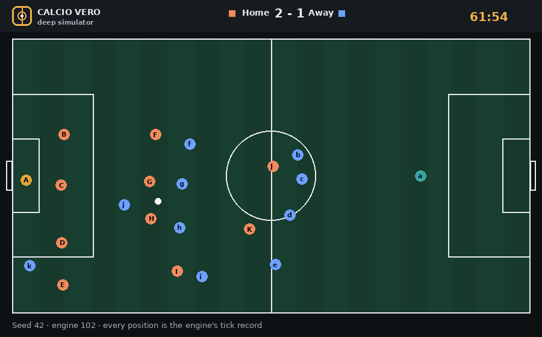
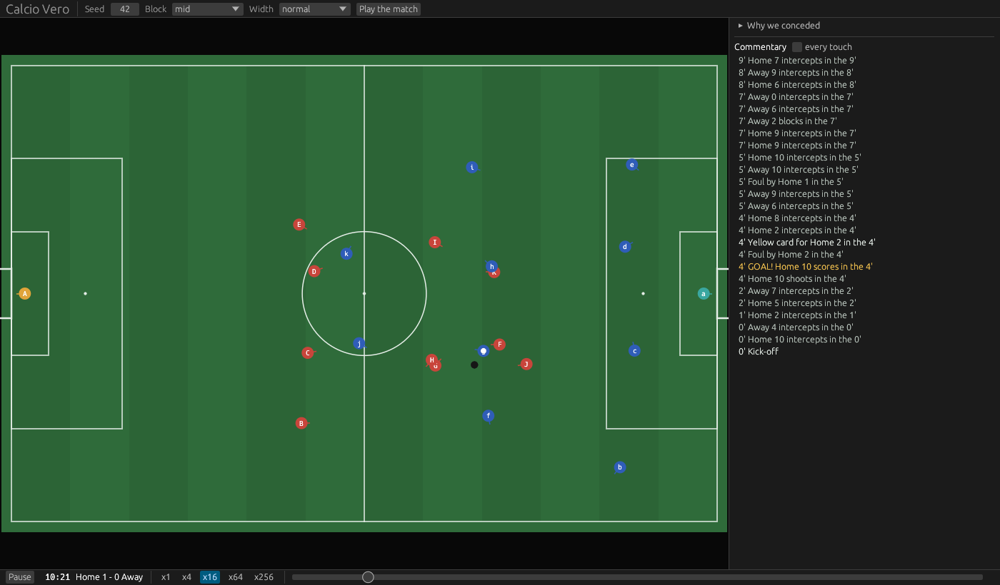

<div align="center">

<picture>
<source media="(prefers-color-scheme: dark)" srcset="assets/calcio-vero-logo-dark.svg">

</picture>

# Calcio Vero - Deep Simulator

**An open football management game where the match tells you *why*.**<br>
*No star ratings. No hidden dice. No secrets you are not allowed to read.*

[](#where-we-are-honestly)
[](https://github.com/liraan/calciovero)
[](LICENSE-MIT)
[](#build-it-with-us)
[](#ai-disclosure)

[](#support)

</div>

---

> You have been here before. Your striker is "in superb form". The
> scout gave him four and a half stars. You lose 3-0 at home, and the
> match engine shrugs.
>
> Why did he miss? Was it his finishing, the defender, the pressure, the
> pass that arrived on his weak foot? Somewhere a number knows. You will
> never see it.
>
> **Calcio Vero - Deep Simulator is built on the opposite idea.**

<div align="center">



*Seed 42, engine version 102, 61'54" to 62'10": the home side clears, the away side wins it back and `g` scores from 31 metres, with no pass in between. Every frame is the engine's own tick record (where the twenty-two and the ball are, ten times a second), drawn by a script in the style of the coming interface. Home players are `A`-`K`, away `a`-`k`, the goalkeepers in their own colour, the ring is the man on the ball. The GUI as it is today ([ADR-055](doctrine/adr/055-the-gui-is-egui-behind-the-view-model.md)) is in [`assets/demo-gui.gif`](assets/demo-gui.gif) (recorded at engine version 95); the terminal view in [`assets/demo-2d.gif`](assets/demo-2d.gif).*

</div>

## If you play football managers, this is for you

You already know what makes these games great: the squad you built
yourself, the kid from the academy who made it, the season that
turned in February. Calcio Vero - Deep Simulator keeps all of that. What it changes is
**what you are allowed to understand**.

| You know this feeling… | Calcio Vero - Deep Simulator's answer |
|---|---|
| "My team played badly" is the whole post-match analysis. | **Every event has a cause you can read.** "Their 8 pressed your 6 from his blind side four times; he lost the ball twice; the second one was the goal." |
| A 4.5-star player turns out to be a 2-star player. | **The scout gives an estimate *and how sure he is*.** A narrow band is a safe signing. A wide band is a gamble, and you can see it is one. |
| Somewhere, a hidden "current ability" decides everything. | **There is no CA/PA.** A player is what he does: his characteristics, read in the situation, from his own point of view. |
| The result feels like a dice roll you are not shown. | **No die is ever rolled in a match.** What looks like luck is a cause you have not spotted yet, and the game can show it to you. |
| You cannot check the formulas, only argue about them on forums. | **Every formula is public.** Every parameter is a JSON file. Change a number, replay the same match, watch what changes. |
| You lose a great save to a patch. | **Same save + same match = same result, on every machine.** Saves are reproducible from their seed. |

## The match: decisions, and a ball with physics

The players are not puppets moved by a script. Each one is an **actor**:
he sees the pitch from where he stands, with his own vision and his own
reading of the game, and he chooses. A late pass is late *because* the
passer was under pressure and looked up a moment too slowly. A defender
who arrives a step late arrived late for a reason.

The ball is the other half. It does not choose: it has declared physical
properties, gravity, friction, the bounce off the post, computed in
integers so that the same match is the same everywhere.

That is the whole design: **the players decide, the ball obeys physics,
and every event carries the reason it happened.** The rest of the game,
from scouting to the academy, is built so that you can ask "why?" and
get an honest answer.

## What you will do as a manager

The loop is familiar, and that is the point:

```
between matches:   observe  ->  understand  ->  decide  ->  (the match)
inside the match:  watch    ->  understand  ->  adjust  ->  (watch)
```

Two cycles, one inside the other, each on its own clock. **Between
matches** you **observe** what your players actually did, through
ratings and data built from events and the reports of your staff, never
from hidden numbers; you **understand** why; you **decide** the eleven,
the tactic, the training, the signings. **Inside the match** you
**watch** it, in a 2D view or as radio commentary; you **understand**
what is happening, down to the moment and the reason; you **adjust**
from the touchline, at half-time, with the substitutions. In both,
understanding comes before acting: you change because you understood,
not because a number went up.

The soul is old-school: dense, readable screens, text commentary, a
world that reacts. Think of the depth of the modern games with the soul
of the classic Italian ones. The longer version is in
[`doctrine/VISION.md`](doctrine/VISION.md).

## Where we are, honestly

**There is no playable game yet.** This is an early prototype of the
match engine, built in the open, one verified step at a time.

What exists today:

- a **deterministic match engine** for one match, with players who
  perceive, choose and move, a ball that flies, a goalkeeper who
  positions himself, posts and crossbar that deflect the ball;
- the **same match on every machine**: since engine version 101 the
  engine's mathematics no longer goes through the operating system's C
  library, and the golden match is checked with two of them;
- a **desktop window** (egui) that replays the match on a 2D pitch with
  the commentary, and a **2D debug view** in the terminal, a text board
  and an HTML page with the result;
- **every goal with its scorer**, own goals told as such, and *why* you
  conceded each one;
- a **friendly you can play** from the command line: choose your eleven
  from the squad and the bench, how high you defend and how wide you play,
  your substitutions, save the match, reload it, and read why you conceded each goal;
- **421 tests** and a health check that runs on every commit.

What does not exist yet: changing the plan during the match, the season, the
career, the transfer market. And the match is not calibrated yet: today it
has too many goals. The full list is below; the order in which things
arrive is public.

| Milestone | What you get |
|---|---|
| **The match can be watched** | a 2D view of twenty-two players and a ball, from any seed (first version: done) |
| **The match reads as football** | shots, saves, restarts, fouls; a match a fan recognises |
| **A friendly you can play** | pick the line-ups, play ninety minutes, save, reload, read why you conceded (first version: done) |
| **A season**, then **a career** | standings and fixtures; then scouting, the market, the academy |

The second one is the longest. We will not skip it to ship faster: a
match that does not read as football would make everything after it
pointless. Each milestone goes faster with more people: see
[Build it with us](#build-it-with-us).

## What the engine does, and what is coming

✅ done · 🟡 partly done · ⬜ to do. Every value an act reads comes from
the player's characteristics; the full catalogue, act by act, is
[`L0-match/design/ACTIONS.md`](L0-match/design/ACTIONS.md).

**The body**

| | |
|---|---|
| ✅ Run and sprint: a professional's top speed and acceleration, by his characteristics | ✅ Brake and stop, in a straight line |
| ✅ The pace is his: flat out into a contest, in his own time into his place | ✅ Fatigue: grows with the effort, against endurance; half-time rests |
| ✅ Turn: by braking, as well as his joint mobility lets him | 🟡 Jump: in the aerial duel (timing ⬜) |

**The mind** (every player thinks: he imagines his options and judges them, [ADR-052](doctrine/adr/052-every-player-thinks.md))

| | |
|---|---|
| ✅ Perceives from where he stands, with a cone of sight | ✅ Vision: how often he looks around |
| ✅ Game reading, decision making, risk management | ✅ Anticipation, creativity, concentration |

**With the ball**

| | |
|---|---|
| ✅ Receive and control (first touch) | ✅ Short pass, lofted pass, cross, switch |
| ✅ Through ball, into the space ahead of a run | ✅ Carry, in the direction he chooses, at the speed his dribbling allows |
| ✅ Dribble past a man, or shield the ball | ✅ Shoot: power, foot, post, lob; aims inside the post by his own miss |
| ✅ Header at goal | 🟡 Clear: no error yet |

**Without the ball**

| | |
|---|---|
| ✅ Press, challenge: standing, slide or jockey | ✅ Mark, offer for a pass, run in behind |
| ✅ Hold the team's shape, high, mid or low block | ✅ Block a shot; aerial duel shoulder to shoulder |
| ✅ Intercept: step into the passing lane | ✅ Cover the space behind a teammate who presses |
| ✅ Deflect a pass he cannot control | ✅ Discipline and work rate |

**In goal**

| | |
|---|---|
| ✅ Dive: reaction, explosive force, height | ✅ Hold or parry |
| ✅ Claim a ball in the air in his area | 🟡 Position: a rule (between ball and goal), not yet his reading |
| 🟡 Come out: in his area only | 🟡 Distribute: throw from his hands ✅, get set ⬜ |

**The Laws** (the referee is the Laws, applied objectively)

| | |
|---|---|
| ✅ Kick-off, throw-in, goal kick, corner | ✅ Offside |
| ✅ Fouls, advantage, penalties, yellow and red cards | ✅ Free kicks and penalties, the taker chosen by the team, the distances |
| ✅ The referee drawn on the pitch, on the diagonal, hiding nothing | |

**The manager**

| | |
|---|---|
| ✅ Choose the eleven from squad and bench | ✅ The intention: block height and width |
| ✅ Save, reload, replay the same match | ✅ Why you conceded each goal |
| ✅ Substitutions: planned before the kick-off, made at a stoppage | ⬜ Instructions during the match |

**Then** (after the match engine is complete, [VISION](doctrine/VISION.md))

| | |
|---|---|
| ⬜ The match calibrated on real football, derived from the players | ⬜ A season: fixtures and standings |
| ⬜ A career: scouting, the market, the academy | ⬜ The radio commentary |

## Try the engine today

Requires **Rust 1.85+ (stable)**. On Windows, use Git Bash or WSL.

    git clone https://github.com/liraan/calciovero.git
    cd calciovero
    cargo run --release --bin ds-demo -- --seed 42 --tui

Or open the window (egui, [ADR-055](doctrine/adr/055-the-gui-is-egui-behind-the-view-model.md)): choose seed, block and width, watch the match on a 2D pitch with the commentary, click an event to go back to it, and read why you conceded.

    cargo run --release -p ds-gui



The command above is the 2D debug view in the terminal: the twenty-two (`A`-`K` home, `a`-`k` away)
and the ball on a text pitch, with the events as they happen. It works
in Git Bash too. Add `--speed 60` to go faster, `--step` to advance with
Enter, `--frame 30` to print the pitch at the 30th minute. It is a debug
view, and it shows the engine as it is today, stalls included.

Play a friendly: you are the home side.

    cargo run --release --bin ds-demo -- --roster
    cargo run --release --bin ds-demo -- --seed 7 --xi A,B,C,D,E,F,G,H,I,J,K --sub 60:J=P --block high --width wide --why --save friendly.json
    cargo run --release --bin ds-demo -- --load friendly.json --tui

Run it twice: same seed, same match, to the last event. `--roster` shows
who is who: each player has a role and a body that fits it. Then open
[`L0-match/balance/`](L0-match/balance/), change a number (a role's
profile in `profiles.json`, the team's shape in `block.json`), and run it
again.

## Build it with us

Calcio Vero - Deep Simulator is not built by a studio. It is built by people who love
football and want a manager they can read to the bottom, and **it is
designed so that each of them can own a piece**. You do not need to
know the whole project, and for most pieces you do not need to code.

| You know… | Your piece | Code? |
|---|---|---|
| **football** | spot what a fan would not recognise, and tell us where (seed, minute) | no |
| **football** | tune the players' profiles, the team's shape, the duel, the keeper: plain JSON in [`L0-match/balance/`](L0-match/balance/README.md) | no |
| **the Laws of the Game** | write a law the engine does not apply yet (offside, fouls) as a small pure function | a little |
| **tactics** | add a formation, improve how a team moves without instructions | a little |
| **testing, tools, writing** | a test scenario, the 2D view, a clearer document, a translation | some / no |
| **Rust and simulation** | the engine: perception, choice, movement | yes |

Every piece has a page that says what to do and how, and a list of
open tasks for newcomers: start from **[CONTRIBUTING.md](CONTRIBUTING.md)**.
Questions go in [Discussions](https://github.com/liraan/calciovero/discussions);
nothing happens in private.

## For developers

The project is written in Rust, and organised like its own design:
concentric rings, one responsibility per directory, dependencies
pointing inward.

```
doctrine/    the rules everything obeys: foundations, vision, decisions (ADRs)
L0-match/    the match: its spec, its design notes, its parameters, its engine
tools/       demo, fixtures, test harness, test runner
context/     how the work is done: the bookmark, the rules, the ideas, the scripts
```

Start with [`doctrine/00-foundations.md`](doctrine/00-foundations.md),
then [`doctrine/STRUCTURE.md`](doctrine/STRUCTURE.md) and
[`L0-match/README.md`](L0-match/README.md). The three rules you will
meet everywhere:

- **Three planes.** The truth (hidden), the observation (events and
  statistics), the estimate (what the manager sees). Nothing leaks from
  the first to the third.
- **No die in a simulation path**
  ([ADR-035](doctrine/adr/035-no-dice-in-simulation.md)). Determinism is
  by construction.
- **No hardcoded balance.** Every parameter lives in a file, with its
  source or with an honest "arbitrary until calibrated".

Contributions are welcome: code, docs, data, bug reports, honest
criticism. One change per PR, English for code and technical docs, a
source for every factual claim, an ADR for every decision that changes an
invariant, and a human review for everything. The full process is in
[`CONTRIBUTING.md`](CONTRIBUTING.md).

**Continuous integration.** Every push runs the full gate: build,
clippy with warnings as errors, the test suite with the golden hash,
fmt, the health check and the documentation gates
([`context/scripts/gates.sh`](context/scripts/gates.sh)). GitHub is the
primary remote ([`.github/workflows/ci.yml`](.github/workflows/ci.yml));
Codeberg is the backup, with the same gate on Woodpecker
([`.woodpecker/ci.yml`](.woodpecker/ci.yml)).

## License

**Dual license** ([ADR-006](doctrine/adr/006-license.md)):

- **Code**: `MIT OR Apache-2.0` ([`LICENSE-MIT`](LICENSE-MIT),
  [`LICENSE-APACHE`](LICENSE-APACHE)).
- **Assets and documentation**: `CC-BY-NC-SA-4.0`
  ([`LICENSE-ASSETS`](LICENSE-ASSETS)).
- **Trademarks**: the names "Calcio Vero" and "Deep Simulator", together or
  apart, and the logo are project trademarks; the licences do not grant trademark rights.

Calcio Vero - Deep Simulator uses no licensed data: no real squads, no real players, no
scraped databases. Players are fictional; the football is real.

Football Manager is a trademark of Sports Interactive. Calcio Vero - Deep Simulator is
not affiliated with it.

## Support

[](https://ko-fi.com/liraan)

Calcio Vero - Deep Simulator is free and open. Donations are voluntary, one-off, and do
not buy influence over the roadmap.

## AI disclosure

Some documentation and code in this repository was **drafted with AI**,
then **reviewed, corrected and owned by a human**. Every architectural
decision was made by a person; AI drafts, humans decide. We say it
openly because transparency applies to our own process too.

## Contact

Everything happens in public:
[Discussions](https://github.com/liraan/calciovero/discussions) for ideas
and questions, [Issues](https://github.com/liraan/calciovero/issues) for
bugs.

---

<div align="center">

*Transparent by design. Deterministic by construction. Yours by default.*

</div>
